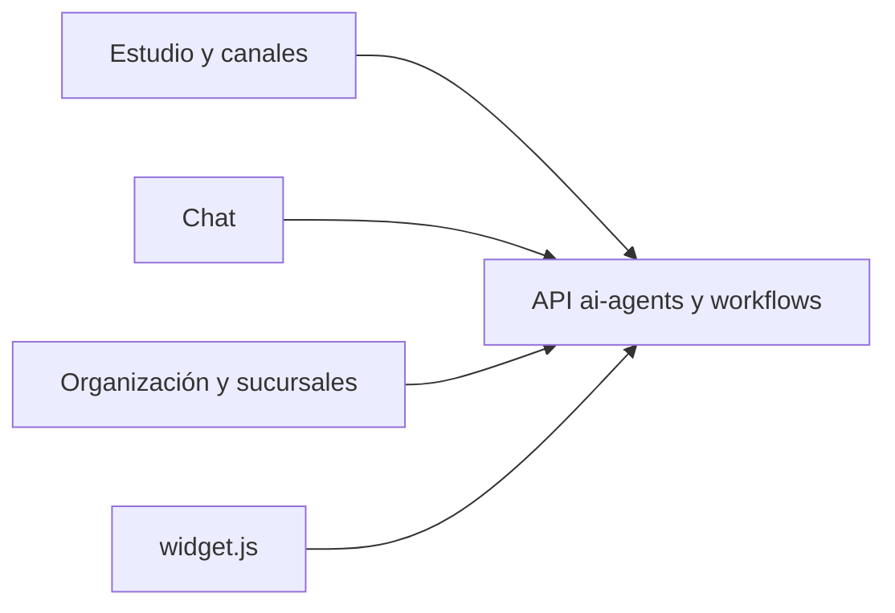

# Arquitectura — Muninn

SPA Vite organizada por rutas de React Router. El cliente HTTP y los hooks están en `src/api`. Los tipos generados caen en `src/api/generated/`.

## Estructura

```
src/routes        pantallas: agentes, chat, APIs, admin de organización, sucursales, tienda, usuarios
src/api           cliente, endpoints, hooks, stream de chat
src/components    estudio, catálogo, conversaciones, shell
src/lib           base URL, modo de auth, tema por sucursal, catálogo
public/widget.js  widget embebible
```

## Flujo



En local, Vite proxea `/api`. En un build, `VITE_API_URL` queda horneada. Por eso cada destino (Pages, Agencia, Void, muninn.yggdra.cl) tiene su propio build: no comparten el mismo bundle.

## Tipos

`scripts/generate-api-types.sh` exige una API local que sirva `/api/schema/`. El chequeo de `docs/CONTRACT_CHECK.md` compara además el sha de producción y falla si los tipos quedan distintos al commit. Muninn todavía no participa de ese job.
